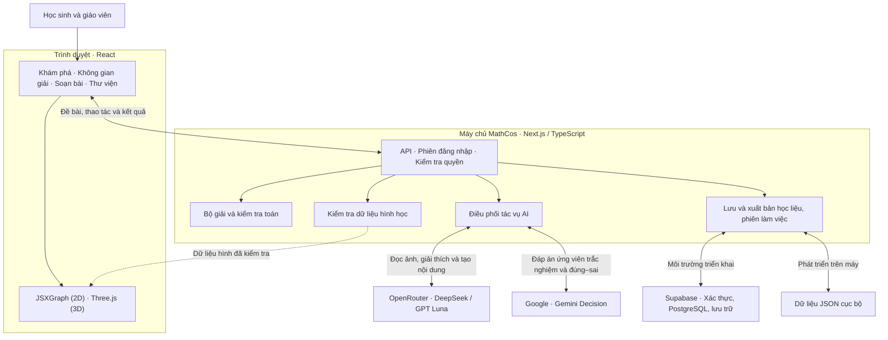

# MathCos

MathCos là ứng dụng web hỗ trợ học và dạy toán. Học sinh có thể giải bài theo từng bước và thao tác trên hình vẽ để hiểu mối liên hệ giữa công thức và đồ thị. Giáo viên có thể tạo bài giảng, phiếu học tập và đề kiểm tra, sau đó chỉnh sửa, xuất hoặc chia sẻ học liệu.

## Tính năng chính

| Khu vực | Tính năng |
| --- | --- |
| **Khám phá** · `/explore` | Dựng hình 2D và 3D bằng công cụ có sẵn, vẽ tay, thay đổi tham số và xoay mô hình. Thêm đồ thị hàm số, biểu đồ, bảng dữ liệu và công thức. Mở hình mẫu hoặc nhập đề bài, mô tả để AI đề xuất hình. |
| **Không gian giải** · `/space` | Nhập đề bằng văn bản, LaTeX, ảnh hoặc nét viết. Hỗ trợ tự luận, trắc nghiệm, đúng–sai và trả lời ngắn. Chọn giải chuẩn hoặc chuyên sâu, xem kết quả theo bước và lưu bài giải. |
| **Soạn bài giảng** · `/studio` | Soạn thủ công hoặc tạo bản nháp bằng AI. Chỉnh sửa văn bản, công thức, hình và hoạt động. Dùng bài giảng dưới dạng trình chiếu 16:9 hoặc phiếu học tập. Khi cần, giáo viên tạo phiếu kiểm tra kiến thức và duyệt điểm, nhận xét do AI đề xuất. |
| **Soạn đề kiểm tra** · `/studio` | Ra đề thủ công, tạo câu hỏi bằng AI hoặc nhập đề có sẵn. Chỉnh nội dung và phương án, tự vẽ hoặc nhờ AI dựng hình cho từng câu, sau đó xuất Word hoặc PDF. |
| **Thư viện** · `/library` | Tìm và xem học liệu, đề kiểm tra đã công khai để dùng lại. Người soạn quản lý bản nháp, xuất bản và chia sẻ học liệu của mình. |

## Kiến trúc tổng thể



## Cách hệ thống xử lý

- **Dựng hình.** MathCos kiểm tra dữ liệu hình học trước khi hiển thị bằng JSXGraph (2D) hoặc Three.js (3D).
- **Giải toán.** Bộ giải nội bộ tính trực tiếp các dạng được hỗ trợ. Với trắc nghiệm và đúng–sai, Gemini Decision đề xuất kết quả ứng viên. Khi cần lời giải, model chính lập luận từ đề gốc. Hệ thống dùng phép kiểm tra nội bộ khi có thể và ghi rõ phần chưa xác minh.
- **Soạn học liệu.** AI tạo nội dung để người dùng xem và chỉnh sửa trước khi lưu, xuất hoặc xuất bản.

Ứng dụng dùng Next.js, React và TypeScript. MathLive hỗ trợ nhập công thức, Tiptap hỗ trợ soạn nội dung và Supabase quản lý tài khoản, dữ liệu và quyền truy cập trong môi trường triển khai.

## Chạy cục bộ

Yêu cầu **Node.js 22 trở lên**.

```sh
npm ci
npm run dev
```

Mở [MathCos trên máy](http://127.0.0.1:3000). Đăng ký tại `/register` để lưu công việc và sử dụng các tính năng cần tài khoản. Trong môi trường phát triển, để trống toàn bộ cấu hình Supabase để dùng tài khoản và dữ liệu JSON cục bộ trong `data/`.

Sao chép `.env.example` thành `.env.local` khi cần cấu hình dịch vụ. Điền khóa ở máy hoặc trong phần quản lý biến môi trường của máy chủ.

| Cấu hình | Dùng cho |
| --- | --- |
| `OPENROUTER_API_KEY` | Các tính năng AI như đọc ảnh, dựng hình từ mô tả, tạo lời giải và soạn học liệu. Model có thể được chọn trong `.env.local`. |
| `GEMINI_API_KEY` | Gemini Decision trong luồng trắc nghiệm và đúng–sai. |
| `SUPABASE_URL`, `SUPABASE_ANON_KEY`, `SUPABASE_SERVICE_ROLE_KEY` | Tài khoản và dữ liệu trên Supabase. |
| `APP_ORIGIN` | Địa chỉ công khai của ứng dụng khi triển khai. |
| `RESEND_API_KEY`, `LESSON_ASSESSMENT_FROM_EMAIL` | Gửi email kết quả phiếu kiểm tra khi đã cấu hình dịch vụ. |

## Build và triển khai

```sh
npm run typecheck
npm run build
npm start
```

Production cần Supabase. Áp dụng các migration trong `supabase/migrations/` theo thứ tự và cấu hình biến môi trường trước khi khởi động. Kiểm tra trạng thái ứng dụng tại `/api/health`. Repo cũng có `Dockerfile` để đóng gói và triển khai.

## Cấu trúc mã nguồn

- `src/app/` chứa các trang và API.
- `src/components/` chứa các thành phần giao diện.
- `src/lib/` chứa logic giải toán, dựng hình, soạn học liệu và truy cập dữ liệu.
- `public/` chứa tài nguyên giao diện.
- `supabase/migrations/` chứa lược đồ và các thay đổi cơ sở dữ liệu.
- `scripts/` chứa công cụ build và vận hành.

Tài liệu dự án, bản thiết kế, dữ liệu mẫu và bộ kiểm thử được giữ cục bộ. Các lệnh kiểm thử trong `package.json` cần bộ tệp kiểm thử tương ứng trên máy.
